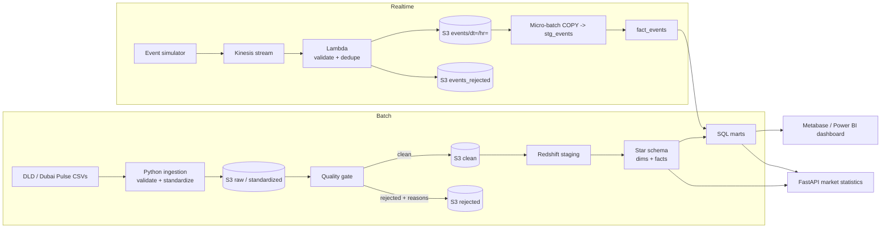

# Architecture



## Data lake layout
```
raw/<dataset>/ingest_date=YYYY-MM-DD/<run>_<file>.csv     immutable source copy
standardized/<dataset>/ingest_date=.../data.parquet       typed, renamed, null-normalised
clean/<dataset>/run_id=<id>/data.parquet                  passed quality rules
rejected/<dataset>/run_id=<id>/data.parquet               failed rules + reasons + full payload
events/dt=YYYY-MM-DD/hr=HH/<batch>.jsonl.gz               valid marketplace events
events_rejected/dt=.../hr=.../<batch>.jsonl.gz            dead-letter events with reason
dq/                                                       schema snapshots, last-ingest stats
```

## Star schema
`fact_transactions` and `fact_rentals` (grain: one registered transaction / tenancy contract) join to `dim_date`,
`dim_area`, `dim_project` and `dim_property` (an attribute dimension holding type, sub-type, usage, registration type
and bedrooms). `fact_events` (grain: one marketplace event) is loaded incrementally and idempotently.
Marts (`mart_*`) are derived tables the dashboard and API read.

## Key decisions
* **Rejected rows are stored, never dropped.** Each carries its reasons and the complete original row as JSON.
* **Quality gate.** If more than `DRE_MAX_REJECT_PCT` (20%) of a file is rejected, the load aborts: usually a
  schema mapping problem rather than bad data.
* **Yield is computed from median price/sqft and median rent/sqft** in the same area and property type over the
  trailing 12 months. Open Ejari data has no bedroom count, so yield is not split by bedrooms.
* **Community names differ between sources.** Marketplace events say "Dubai Marina"; DLD says "Marsa Dubai".
  `seeds/area_aliases.csv` maps them. Unmapped names raise the `event_area_unresolved` warning.
* **Kinesis is at-least-once**, so duplicates are dropped in Lambda (within a batch) and again in
  `22_fact_events.sql` (across batches).
* **Lambda failure semantics.** Bad records are dead-lettered (retrying cannot fix them); an S3 failure returns
  `batchItemFailures` so Kinesis retries.
